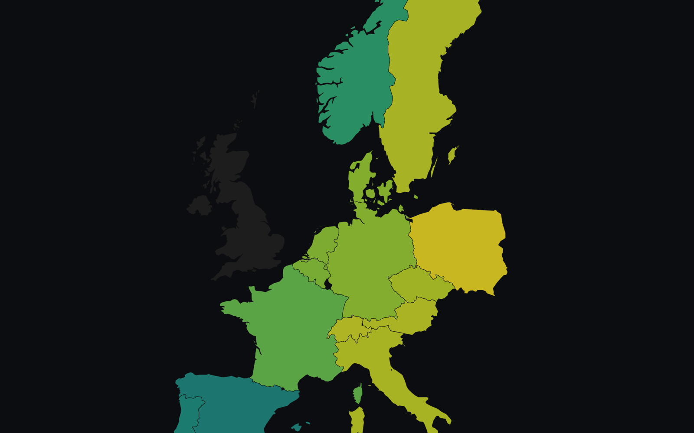

# eu-power-map

<p align="center">
  <a href="https://nickyuryev.github.io/eu-power-map/web/">
    
  </a>
</p>

<p align="center">
  <a href="https://nickyuryev.github.io/eu-power-map/web/">live demo</a>
  &middot;
  <a href="https://github.com/NickYuryev/eu-power-map/actions/workflows/refresh.yml">
    hourly refresh
  </a>
</p>

Live map of European day-ahead power prices, physical cross-border flows and
clean dark spark spreads across 15 countries. Static site, keyless APIs,
refreshed every hour by a GitHub Action.

## What the map shows

- **Price mode** &mdash; each country tinted by its day-ahead clearing price
  (EUR/MWh) for the hour the slider is parked on. Viridis ramp, min/max shown
  in the legend.
- **Spark spread mode** &mdash; the clean dark gross margin for a modern CCGT
  burning TTF gas and paying for its EUA allowances:

  ```
  clean_dark = price - 0.49 * TTF - 0.37 * EUA
  ```

  Divergent RdBu ramp centred on zero. Red zones burn money, blue zones make
  it, white is break-even.
- **Lines** &mdash; physical cross-border flow for the same hour. Width is
  &propto; &radic;MW. Amber means the flow runs toward the alphabetically-later
  ISO (e.g. for "DE-FR", amber is DE &rarr; FR); cyan is the reverse.

Hover anything for the numbers. Drag the slider for a different hour of the
day.

## Run it locally

```sh
# fetch the latest snapshot and serve the static site
uv run scripts/fetch_ttf.py
uv run scripts/snapshot.py
python3 -m http.server 8000
open http://localhost:8000/web/
```

Dependencies install themselves via [uv](https://docs.astral.sh/uv/). Python
3.12+.

Tests:

```sh
uv run pytest
```

## Data sources

| Source | Field | Licence |
|---|---|---|
| [Energy-Charts](https://api.energy-charts.info/) | day-ahead prices, cross-border physical flows | CC BY 4.0 |
| [Yahoo Finance](https://finance.yahoo.com/quote/TTF%3DF) via `yfinance` | TTF front-month daily close | personal/educational use |
| [EEX](https://www.eex.com/) | EUA settlement (manual snapshot in `data/eua.json`) | &mdash; |
| [Natural Earth](https://www.naturalearthdata.com/) 1:50m | country polygons | public domain |

## Limits (honestly)

- **15 countries.** AT, BE, CH, CZ, DE, DK, ES, FR, GB, IT, NL, NO, PL, PT, SE.
  One representative bidding zone per country (so DK is DK1, IT is IT-North,
  etc.). GB currently has no Energy-Charts coverage, so it stays dark.
- **Hourly refresh**, 17 minutes past the hour. Energy-Charts physical flow
  data lags real time by ~2 h, so the last few hours of today will be empty
  until later in the day.
- **EUA is a static snapshot.** It is refreshed by hand in `data/eua.json`.
  Spreads drift from reality between refreshes.
- **No basemap.** Carto's dark raster now requires an API key; the plain dark
  background keeps this keyless.

## Licence

MIT. See [LICENSE](LICENSE).
